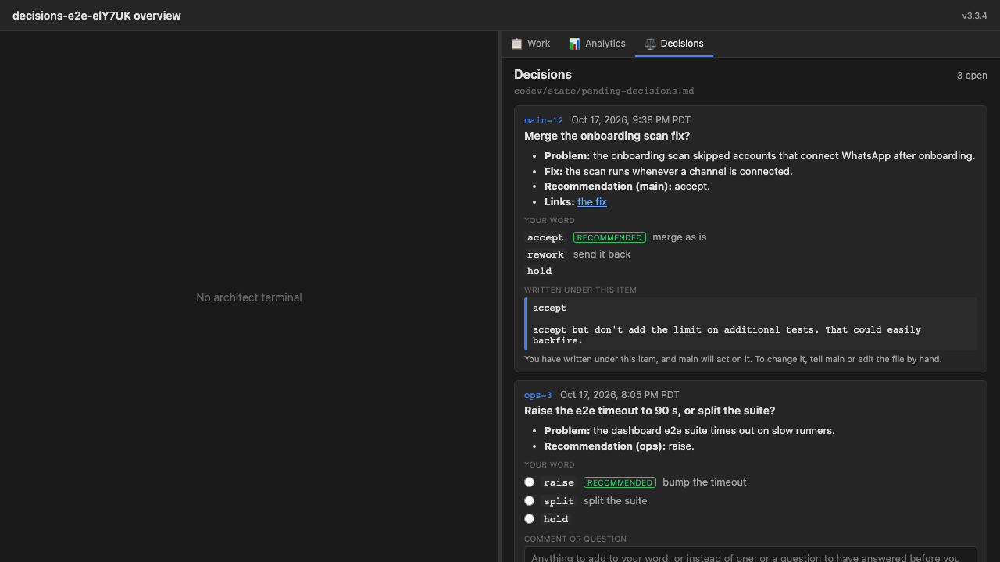
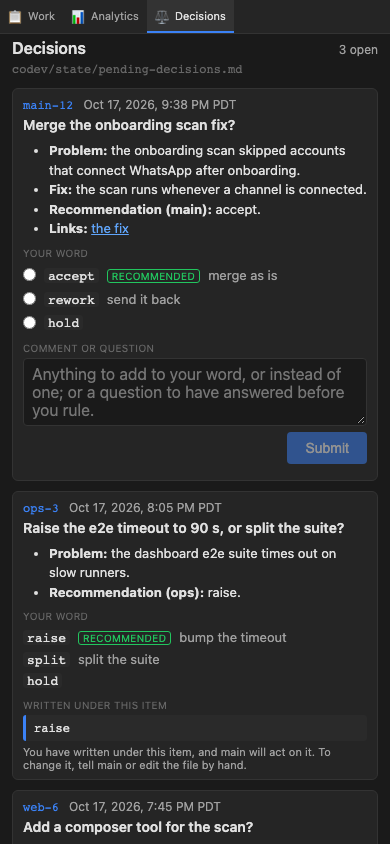

# Review: Tower Decisions tab — a UI view of the pending-decisions file

## Summary

Added a **Decisions** tab to the Tower dashboard. It is a view of a workspace's
`codev/state/pending-decisions.md` (configurable as `dashboard.decisionsFile`). Each open item
becomes a card with its options as radio buttons (the recommended one marked), a comment-or-question
box and Submit. Submit writes the owner's word and comment on the lines right after the item's
`**Your word:**` line, and nothing else in the file changes. The work was built in 7 plan phases:
the server-side read model, a pure splice, Tower routes with serialized atomic writes, the tab
shell, read-only cards, ruling from the tab, then Playwright and docs. Every phase was approved by
both reviewers. On the merged branch, the build, the codev unit suite (6451 passed / 48 skipped),
the web suite (499 passed / 1 skipped) and the 9-test browser suite all pass.





## Spec Compliance

- [x] A workspace whose decisions file exists shows a **Decisions** tab on desktop and in the mobile layout; a workspace without it shows none (Phase 4; e2e in Phase 7). The tab appears when the file exists and then stays for the page session (see Deviations).
- [x] Each `## Open` item is a card in file order with id, local-time timestamp, question and markdown body; `http(s)` links open in a new browser tab and no click navigates the dashboard away (Phase 5; e2e link test in Phase 7).
- [x] Each writable card shows one radio per option, in order, with descriptions; the first is marked *Recommended* (Phase 6; read-only cards keep Phase 5's inert option list). Each option reads inline as "word: description". When the Your-word line carries bare words, the description comes from the body's **Options:** entry (owner's change at the PR gate).
- [x] One comment box and Submit per writable card; Submit is disabled until a word is chosen or the comment is non-blank, and while that card's submit is in flight (Phase 6).
- [x] A submit inserts exactly the bytes defined in "Writing (the splice)", unit-tested byte for byte for word, comment, word + comment and multi-line comment, plus a 500-case property test that every original byte is kept in order (Phase 2). The e2e tests check the file on disk equals the original plus only the inserted lines (Phase 7).
- [x] Every refusal returns a specific code and message, leaves the file byte-identical, shows the message on the card and keeps the draft (Phases 2, 3, 6).
- [x] Writes are serialized per file (one `KeyedSerializer` per canonical path) and replace the file atomically (fsynced temp file renamed over it). Of two concurrent submits to one item, exactly one applies and the other is refused `already-ruled` (Phase 3).
- [x] A successful submit's response re-renders the card at once (`applyDocument`, which also discards an in-flight stale poll) (Phases 4, 6).
- [x] An item with text after its Your-word line shows it verbatim as the current ruling and is read-only; duplicate-id items and items without exactly one Your-word line are read-only with a notice (Phases 1, 5).
- [x] Question-and-answer pairs render as a thread in file order, not duplicated in the body, with their `(time)` stamps as written (Phases 1, 5).
- [x] Question round-trip end to end: a comment-only question is written after the Your-word line and the card goes read-only; once the pair is above the line and nothing follows it, the card is writable again and shows the thread (component test in Phase 6, e2e in Phase 7).
- [x] `## Ruled` shows below the cards, read-only, collapsed by default; once opened it stays open across polls (Phase 5).
- [x] An external write appears in the open tab within a few seconds (2 s poll; about 2 s measured in the browser) without a refresh, and drafts survive it (Phases 4, 6; e2e in Phase 7).
- [x] A draft whose item stops being writable is held, visible and copyable, until discarded, including when the file disappears (Phase 6; e2e in Phase 7).
- [x] Timestamps convert from the zone written in the stamp to the viewer's zone for every accepted form. Unknown zones and DST gap/fold times are shown verbatim and marked unconverted. The tests cover PT in both DST states, every fixed abbreviation, each generic zone, non-US offsets, UTC/GMT/Z, an IANA name, unknown and excluded zones, a gap and a fold, and run under several `TZ` values. No path assumes PT (Phase 1 resolver, Phase 5 display under `TZ=America/New_York`).
- [x] The path is configurable through `dashboard.decisionsFile` with default `codev/state/pending-decisions.md`. A path whose canonical location is outside the workspace (directly, through `..`, or through a symlink) is refused for read and write (Phase 3; config override e2e in Phase 7).
- [x] The parser and the splice are pure functions with their own unit tests against the spec's format, including malformed input and edge cases (Phases 1, 2).
- [x] The tab is exercised in a real browser through Playwright: render, choose + comment + submit, file updated on disk, external change re-rendered with the draft intact (Phase 7). Phases 4–6 each also ran a browser check.
- [x] The new routes sit behind the same `isRequestAllowed` check as every other workspace route; requests without the key are rejected (Phase 3, tested through `handleRequest`).

### Verification evidence

- **Browser suite** (`packages/codev/src/agent-farm/__tests__/e2e/decisions-tab.test.ts`, 9 tests), run through its own config on a throwaway Tower with its own port, state dir and socket dir, against `mkdtemp` workspaces. The tests cover:
  - choose + comment + submit;
  - an external write with a draft in another card;
  - the question round-trip;
  - a link opening a new page while the dashboard stays put;
  - the file deleted (not-found, held draft);
  - the config override;
  - no file, no tab;
  - phone width with tap;
  - an annotator file tab following a ruling written by rename.

  Locally, 9/9 with 0 shellpers started, and `git status --ignored codev/state/` unchanged.
- **dashboard-e2e** (runs only on schedule or dispatch, so it was dispatched on this branch):
  - [39058813921](https://github.com/cluesmith/codev/actions/runs/39058813921) on `5a200fd24`: Decisions 8/8;
  - [39059250714](https://github.com/cluesmith/codev/actions/runs/39059250714) on `e20acb2a7`: 8/8;
  - [39059487181](https://github.com/cluesmith/codev/actions/runs/39059487181) on `1c4a5a35a`: Decisions 9/9 with no retries; main suite 66 passed, 4 skipped, 1 flaky (see Flaky Tests);
  - [39060162578](https://github.com/cluesmith/codev/actions/runs/39060162578) on the merge with main (`b0a84b0a0`): success. Decisions 9/9 (16.1 s, no retries); main suite 67 passed, 4 skipped, none flaky.
- **Unit suites on the merged branch:** `packages/codev` build exit 0; codev unit 6451 passed / 48 skipped; `apps/web` 499 passed / 1 skipped (the pre-existing skip on main).
- **After the PR review round's link and config changes:**
  - web suite 500 passed / 1 skipped; `tsc -b` clean;
  - browser suite 9/9 locally on a fresh build, 0 shellpers left;
  - a server already listening on the suite's port now fails the run ("http://localhost:14101 is already used") instead of being reused;
  - dashboard-e2e [39061143299](https://github.com/cluesmith/codev/actions/runs/39061143299) on `fb1bcbc71`: success. Decisions 9/9, no retries; main suite 66 passed, 4 skipped, 1 flaky (the same pre-existing `spec-823` N=3 test).
- **After the PR gate's inline-options change (`d6e1aae76`):**
  - codev unit 6461 passed / 48 skipped; web 501 passed / 1 skipped; type-checks clean;
  - dashboard-e2e [39106067568](https://github.com/cluesmith/codev/actions/runs/39106067568): success. Decisions 9/9, including the bare-word item read in Chromium as "raise: bump the timeout Recommended" / "split: split the suite" / "hold"; main suite 67 passed, 4 skipped, none flaky;
  - the architect checked the change on a throwaway Tower before relaying the human's approval.

  The embedded screenshots come from the earlier run, before options read "word: description" with the badge after.

## Deviations from Plan

- **Phase 1:**
  - The fingerprint covers the heading through the item's last non-blank line, not the item's whole region, so changing the blank lines between two items is not an edit of either (claude's review).
  - A file with two `## Open` sections is a file problem (`open-multiple`) and makes every item read-only.
  - An option's description is only the text after `=`.
  - `## Open` / `## Ruled` are classified in `parse.ts`, not `grammar.ts`; this has no behavioural effect.
- **Phase 2:**
  - New refusal code `open-multiple`.
  - The verification goes one step past the spec's comparison list: every inserted line must also re-parse as plain, unfenced content. Without that, an option word like `` `####` ``, or `` `~~~` `` in the last item, passes the spec's checks.
  - A comment's CR, LF and CRLF line breaks are all rewritten in the file's own line ending.
- **Phase 3:**
  - GET answers `{ ok: true, document }` rather than `{ document }`, so both routes share one response shape.
  - New refusals:
    - `not-utf8` (422): a file whose bytes don't round-trip through UTF-8 would otherwise be rewritten with U+FFFD.
    - `write-failed` (500): an I/O failure returns the typed refusal shape, so the card still has a message (claude's review).
  - An absolute `dashboard.decisionsFile` is a config error (codex's review).
  - The default path is a constant, not part of `DEFAULT_CONFIG`, so `getDefaultConfig()` starter configs don't change.
  - Containment walks up to the nearest existing ancestor, so a path into a missing directory outside the workspace is refused rather than throwing.
  - The handlers take Tower's logger, and the state flag's config-error log is deduped per workspace.
- **Phase 4:**
  - `fetchDecisions` returns a `{ kind }` union.
  - The `error` state keeps the last document, so a tunnel blip shows a banner over the cards rather than unmounting them under someone typing.
  - The sticky tab uses React's set-state-during-render pattern rather than a ref (same behaviour).
- **Phase 5:**
  - The plan's stamp formula (`toLocaleString` with `dateStyle` + `timeStyle` + `timeZoneName`) throws (ECMA-402), so the view uses explicit fields.
  - The canvas tokens are overridden on `.decisions-view .codev-artifact-canvas-rendered`, not `.decisions-view`: the theme declares them on the renderer's own root, so an ancestor override would lose.
  - Link handling tests the raw `href` attribute, so a repo-relative link stays inert instead of opening a dashboard URL.
  - A card whose heading has only an id is named by its id (claude's review).
- **Phase 6:**
  - Additions:
    - A **Clear choice** button, because a radio cannot be unchosen, and without it a word chosen before deciding to ask a question would be sent with the question.
    - A "Show it" pointer from a live card to its held draft at the top of the tab.
    - A 16 px comment box at phone width, so iOS doesn't zoom.
  - Drafts are reconciled on every render, not only when a new document arrives.
  - A throw from the send is shown on the card (claude's review).
  - No `maxLength` on the comment box, because it would silently truncate a paste; the server refuses an over-long comment and the draft is kept.
- **Phase 7:**
  - The plan assumed the default Playwright config. The suite runs through a dedicated `playwright.decisions.config.ts` with no global setup, which `testIgnore`s it from the default config. That config refuses to start unless `TOWER_TEST_PORT` (not 4100), `CODEV_AGENT_FARM_DIR` and `SHELLPER_SOCKET_DIR` are all set, and a separate CI step runs it on port 14101 (codex's reviews).
  - A ninth test replaces the plan's "covered in the Phase 7 manual pass" for the annotator risk.
  - The screenshots are committed under `codev/reviews/1819-tower-a-decisions-tab-a-ui-vie/`.

- **PR review round:**
  - Links are made inert on the anchors themselves, not only in the click handler. Every `MarkdownView` in the view renders through a `DecisionsMarkdown` wrapper that removes the `href` from non-`http(s)` anchors and gives `http(s)` anchors `target="_blank" rel="noopener noreferrer"`. This covers a middle-click, the context menu and the keyboard. The shared renderer is still unchanged.
  - `playwright.decisions.config.ts` no longer reuses a server already on its port.
- **PR gate (owner's change request after trying the tab):**
  - On an item whose `**Your word:**` line carries bare words (`raised` / `rotated` / `wait`), the radios showed only the words, and the owner had to look back up at the body's **Options:** line.
  - The parser now fills a bare option's description from the body's **Options:** entry for that word, in the forms `(a) `w` = …`, `(a) `w`: …` and a `- `w` = …` list. The Your-word line's own `= …` still wins, and a word with neither stays bare. The body is shown unchanged.
  - Every option now reads "word: description", with the Recommended badge after it.
  - The spec's Parsing section and test scenarios are updated. The e2e fixture's `ops-3` item now has this shape, so the browser suite and the screenshots exercise it.

The owner's plan-time format question (YAML/JSON/hybrid instead of markdown) was answered in the plan's Format Evaluation: keep markdown. The plan was approved on that basis.

## Consultation Feedback

Consultation ran with two reviewers, Codex and Claude: this workspace's `.codev/config.json` lists `consultation.models: ["codex", "claude"]`, so there was no Gemini lane. There was no `CONSULT_ERROR`.

Several phase 3–7 outputs carry the "working tree changed during review" warning (#1649):
- In phases 3–6 the changed path is `.builder-state.md`, my untracked state file, written during a context refresh. It is not part of the branch.
- In phase 7 iteration 1, the changed paths are my in-progress edits for codex's fix (named in that round's rebuttal), committed together in `5a200fd24`.

### Specify Phase (Round 1)

#### Codex — REQUEST_CHANGES
- **Concern**: path containment ignored symlinks → **Addressed**: canonical (realpath) containment at every read and write; a symlinked file keeps its link.
- **Concern**: comment validation incomplete (unclosed fence, indented headings, Your-word in fences) → **Addressed**: an explicit CommonMark-subset grammar; refusals for heading, fence and Your-word lines; re-parse verification as a catch-all.
- **Concern**: duplicate ids vs drafts keyed by id → **Addressed**: duplicate-id items are entirely read-only; a draft whose item becomes a duplicate is held.
- **Concern**: timestamp rules under-specified (abbreviations, DST gaps/folds) → **Addressed**: an enumerated zone table; ambiguous abbreviations excluded; gap/fold left unconverted.

#### Claude — REQUEST_CHANGES
- **Concern**: no serialization or atomic write → **Addressed**: per-file serialization, temp file + rename, second concurrent submit refused.
- **Concern**: "same bytes as hand-typed" untestable; blank-line assumption unverifiable → **Addressed**: the criterion became the pinned splice bytes; the leading blank line was dropped; the hub's scan contract was confirmed at the gate (Open Question 1, resolved).
- **Concern**: re-ruling leaves two words → **Addressed**: an item with a current ruling is read-only.
- **Concern**: unclosed fence in a comment → **Addressed**: fence-line refusal plus verification.
- **Concern**: success response unspecified → **Addressed**: it returns the re-parsed document.
- **Concern**: timestamp cost understated → **Addressed**: `Intl` offset probing, no dependency, stated in the approach.
- **Concern**: links navigate the SPA away → **Addressed**: a click handler on the Decisions view's own container; the shared renderer is unchanged.
- **Minor** (comment length cap, realpath, letters) → **Addressed**: 10,000-character cap; realpath; the tab offers and writes the option word.

### Plan Phase (Round 1)

#### Codex — REQUEST_CHANGES
- **Concern**: `useDecisions` could let a stale poll overwrite a write → **Addressed**: skip-while-in-flight plus a generation counter bumped by `applyDocument`.
- **Concern**: e2e would write the real workspace's decisions file → **Addressed**: throwaway `mkdtemp` workspaces only.
- **Concern**: option tokenization vs ` / ` in descriptions → **Addressed**: ` / ` starts an option only when followed by a backtick.

#### Claude — REQUEST_CHANGES
- **Concern**: e2e against the live Tower / repo workspace → **Addressed**: explicit non-4100 `TOWER_TEST_PORT`, throwaway workspaces.
- **Concern**: "file disappears → not-found, held drafts visible" unreachable under Team-style gating → **Addressed**: the tab is conditional, then sticky for the page session.
- **Concern**: `decisionsEnabled` costs `loadConfig` on every 1 s state poll → **Addressed**: the configured path (only) is memoized for 5 s for the flag; the routes read config fresh.
- **Concern**: theme CSS import location → **Addressed**: imported from `main.tsx`.
- **Concern**: `structure-changed` covered by mocking → **Addressed**: reached with real pathological option words.
- **Concern**: Phase 4 too large → **Addressed**: split, giving 7 phases.

### Phase 1 (Round 1)

#### Codex — REQUEST_CHANGES
- **Concern**: Q&A continuation swallowed unindented prose and `####` headings → **Addressed**.
- **Concern**: `parseOptions` dropped later options and read text without `=` as a description → **Addressed**.
- **Concern**: a heading with one ` · ` was read as question-only → **Addressed**: the first part is the stamp.

#### Claude — REQUEST_CHANGES
- **Concern** (blocking): `in` on the zone tables let `toString` / `__proto__` through and the parse threw → **Addressed**: `Object.hasOwn`, plus test rows.
- **Concern**: mixed option line; `####` absorbed into Q&A → **Addressed** (same as codex).
- **Concern**: CRLF ruling is LF-normalized, a trap for Phase 2 → **Addressed**: documented, and Phase 2 compares LF-normalized text.
- **Concern**: fingerprint included the blank lines after the item → **Addressed**.
- **Nits** (`TZ` teardown, `detectLineEnding` comment) → **Addressed**.

### Phase 1 (Round 2)

- Codex: APPROVE, no concerns.
- Claude: APPROVE. Non-blocking notes and their disposition:
  - `parseOptions` guard for a missing label → **Addressed** in Phase 2.
  - Multi-word backticked spans accepted as words, and an unclosed backtick truncating a description → **N/A**: malformed input, harmless.

### Phase 2 (Round 1)

- Codex: APPROVE, no concerns.
- Claude: APPROVE. Minor notes:
  - `comment-fence` over-refuses a line like `` ``` `a` ``` `` → **Rebutted**: the safe direction, and it matches the spec's grammar. The wording is listed as a follow-up.
  - Comment length counts UTF-16 units → **N/A**: immaterial at 10,000.
  - `'ok' in item` narrowing → **N/A**: nit.
  - Phase 3 must map `open-multiple`, `empty-ruling` and `invalid-request` → **Addressed**: the status map is an exhaustive `Record` over the refusal codes.

### Phase 3 (Round 1)

- **Codex — COMMENT:**
  - An absolute configured path was accepted → **Addressed**: it is now a config error.
- **Claude — APPROVE:**
  - I/O failures escaped as a generic `{ error }` 500 → **Addressed**: typed `write-failed`.
  - The read path had no logger → **Rebutted**: GET is polled every 2 s, so logging its refusals would repeat every poll. The state flag already logs a config error once per workspace.
  - A directory at the path reads as `not-found` → **N/A**: nit, left as is.
  - No directory fsync → **N/A**: the reviewer agreed it is not needed for the claimed guarantee.

### Phase 4 (Round 1)

- Codex: APPROVE, no concerns.
- Claude: APPROVE. Notes:
  - A file appearing mid-session takes focus through `useTabs`' existing auto-switch → **N/A**: same as the Team and builder tabs. Listed as a follow-up.
  - Set-state during render → **N/A**: legal, kept.
  - Re-activation during a fetch waits for the next tick → **N/A**: up to 2 s.
  - File-problem notices had no `role` → **Addressed** in Phase 5.
  - Confirm the web suite is green on CI's Node 20 → **Addressed**: green; the local failures are a Node 26 artifact.

### Phase 5 (Round 1)

- Codex: APPROVE, no concerns.
- Claude: APPROVE. Notes:
  - A question-less card got an empty accessible name → **Addressed**.
  - `auxclick` bypasses the handler → **Rebutted** at the time (a middle-click opens a new tab, which never navigates the dashboard). Withdrawn in the PR review round, when codex raised the same gap; now **Addressed** (see below).
  - Bundle +139 kB → **N/A**: the cost of baked decision 1. Lazy-loading is listed as a follow-up.
  - Keep options inert on read-only cards → **Addressed** in Phase 6.
  - Save the screenshots → **Addressed** in Phase 7.

### Phase 6 (Round 1)

- Codex: APPROVE, no concerns.
- Claude: APPROVE. Notes:
  - `onSubmit` had no catch, so a throw would lock the card → **Addressed**.
  - Render the reconciled state, not the pre-reconcile object → **Addressed**.
  - `maxLength` → **Rebutted**: it would silently truncate; the server refuses with a message and the draft is kept.
  - Node 26 `localStorage` → **N/A**: environmental; CI is Node 20.

### Phase 7 (Round 1)

- **Codex — REQUEST_CHANGES:**
  - The default config's global setup activates the repo workspace and starts a shell → **Addressed**: dedicated config with no global setup, `testIgnore` in the default config, and a separate CI step.
  - Screenshots not durably recorded → **Addressed**: committed and embedded above.
- **Claude — COMMENT:**
  - Config/CI changes were uncommitted during the review → **Addressed**: they were mid-edit for codex's fix and landed together in `5a200fd24`.
  - The title wait assumed no Tower cloud name → **Addressed**: it is now a regex.
  - Screenshots → **Addressed**.
  - dashboard-e2e doesn't run on PRs → **Addressed**: dispatched per commit, results above.

### Phase 7 (Round 2)

- **Codex — REQUEST_CHANGES:**
  - The test Tower shared `~/.codev/run` (socket probing, husk sweep) → **Addressed**: the config refuses without `SHELLPER_SOCKET_DIR`, `CODEV_AGENT_FARM_DIR` and a safe port; CI sets them.
  - No completed CI result recorded → **Addressed**: run 39058813921 (8/8).
- **Claude — APPROVE.** Minor notes:
  - Both CI steps on port 14100 → **Addressed**: the Decisions step uses 14101.
  - State-dir isolation only documented → **Addressed**: enforced.

### Phase 7 (Round 3)

- Codex: APPROVE, no concerns.
- Claude: APPROVE. Minor notes:
  - The state-dir and socket-dir guards live only in the config → **Rebutted**: the config is the only way the suite runs, and it refuses before any Tower starts.
  - Committed screenshots can drift from the UI → **N/A**: they are evidence for this change, dated by the run.
  - dashboard-e2e not on PRs → **N/A**: a separate decision.

### Review (PR) Phase (Round 1)

- **Codex — REQUEST_CHANGES:**
  - Non-http(s) links are not fully inert: a middle-click or the context menu could still open them → **Addressed**. Inert anchors lose their `href`; `http(s)` anchors get `target="_blank" rel="noopener noreferrer"`. Tested, and mutation-checked.
  - The approved spec and plan lack frontmatter → **Addressed**: `approved: 2026-10-17`, `validated: [codex, claude]`.
  - Three `-context.md` consultation files were untracked → **Addressed**: committed, as other projects' are.
- **Claude — APPROVE.** Minor notes:
  - The Decisions config inherited `reuseExistingServer: true` → **Addressed**: it declares its own `webServer` with `reuseExistingServer: false`.
  - A comment starting with `---` / `===` can setext-promote the Your-word line in other viewers → **N/A**: setext is non-structural by spec, and the tab and `main`'s scan are unaffected. Listed as a follow-up.
  - Read-path I/O errors are not a typed refusal → **N/A**: the client degrades correctly and nothing is lost. Listed as a follow-up.
  - `--retries 3` on the CI Decisions step → **Rebutted**: it mirrors the main step, and Playwright reports a retried pass as flaky. The recorded runs had no retries.

## Lessons Learned

### What Went Well

- **Putting all parsing on the server paid off.** The read route and the write route use one parser and one grammar, so what the owner sees and what a write validates cannot disagree. Every later phase built on a tested definition of "item", "option" and "current ruling".
- **Re-parse verification found real holes.** Pathological option words (`##`, `####`, `~~~`) pass every explicit check, and only the verification refuses them. That also made `structure-changed` reachable in tests without mocks.
- **Fail-loud refusals with the draft kept** made every failure mode testable as "file byte-identical, message on the card, draft intact".
- **Each review round improved the design:** read-only once ruled, serialized atomic writes, the sticky tab, stale-poll protection, the isolated e2e config. Every request for changes was accepted; none was disputed.

### Challenges Encountered

- **Keeping the browser suite away from the live Tower.** This took three review rounds. The repo's default Playwright config activates the repo workspace. Isolating the state dir left the socket dir shared with the live Tower, where the test Tower probes sockets and husk-sweeps. It was resolved with a dedicated config that refuses to start without all three isolating variables.
- **Local toolchain drift.** Node 26's built-in `localStorage` breaks 74 unrelated web tests locally (fixed with `NODE_OPTIONS=--no-experimental-webstorage`). `@playwright/test` 1.59.1 wants a chromium build that isn't in the local cache, so local runs used a scratchpad config pointing at the cached build. CI is unaffected by either.
- **Time zones without a date library.** Wall-clock to instant for IANA and generic zones is built on `Intl` offset probing, with gaps and folds detected by counting the candidate offsets that match.

### What Would Be Done Differently

- Check the plan's risk table against the tests before the last implementation phase. "Covered in the manual pass" for the annotator risk had not been done. As a test it found a pre-existing annotator gap.
- Write the e2e isolation requirements, all three variables, into the plan up front. The plan named only the port.

### Methodology Improvements

- The review phase's `e2e_tests` check runs `vitest.e2e.config.ts`, not the Playwright suites. A project whose browser suite lives in `dashboard-e2e` (schedule or dispatch only) has to dispatch it by hand. A porch check, or a `pull_request` trigger for the Decisions step, would make that evidence automatic.
- The #1649 working-tree warning fires on the builder's own untracked state file when a context refresh overlaps a consultation. Excluding `.builder-*` files would remove the noise.

## Architecture Updates

- Routed: cold — a **Decisions View** entry in `codev/resources/arch.md`, beside Team View (Phase 7). It covers the conditional-then-sticky tab and `decisionsEnabled`, the two routes and their refusal status map, the server-side parser modules, serialized atomic writes, race-safe polling and held drafts.
- Hot (`arch-critical.md`): no change. The feature is one dashboard view and one config key; no future builder needs it up front. The hot file is at its cap.

## Lessons Learned Updates

Routed to cold `codev/resources/lessons-learned.md`:

- Routed: cold — Testing — a browser suite that writes needs its own Playwright config with no global setup, and must refuse to start unless the port (not 4100), `CODEV_AGENT_FARM_DIR` and `SHELLPER_SOCKET_DIR` are all isolated.
- Routed: cold — Testing — Node 26's built-in `localStorage` shadows jsdom's; run the web suite locally with `NODE_OPTIONS=--no-experimental-webstorage`.
- Routed: cold — UI/UX — to re-theme `MarkdownView` in a host, override the canvas tokens on `.codev-artifact-canvas-rendered`, not on an ancestor.
- Routed: cold — UI/UX — when intercepting link clicks, test the raw `href` attribute, not the resolved `anchor.href`.
- Routed: cold — UI/UX — `Intl.DateTimeFormat` throws when `timeZoneName` is combined with `dateStyle`/`timeStyle`; use explicit fields.
- Routed: cold — Process — make a risk-table "covered in the manual pass" mitigation a test.

Hot (`lessons-critical.md`): no change. These are subsystem-specific, and the hot file is at its cap.

## Flaky Tests

No test was skipped by this project. Observed, pre-existing, and unrelated to this change:

- `packages/codev/src/agent-farm/__tests__/e2e/spec-823-builder-attribution.test.ts`, "N=3 — attribution renders for three sibling architects": failed once and passed on retry in dashboard-e2e runs 39059487181 and 39061143299. The file is untouched here.
- `apps/web/__tests__/Terminal.fit-scroll.test.tsx`: an `it.skip` marked FLAKY that is already on main. It accounts for the web suite's one skip.

## Follow-up Items

- **Annotator first-second blind spot** (`packages/codev/templates/open.html`): the viewer takes its first mtime reading about a second after load as the baseline, so a write in that first second isn't shown until the next write. Found by the Phase 7 annotator test. Not changed here.
- **Move the adopter's `decision-protocol.md` into the skeleton**, as the issue offered, now that the tab exists.
- **Repo paths in `Links:` as Tower file tabs** (spec Open Question 6); they render as text today.
- **Lazy-load `DecisionsView`** to take markdown-it, linkify and DOMPurify (+139 kB minified) out of the dashboard's main chunk.
- **Run the Decisions e2e step on pull requests.** dashboard-e2e is schedule/dispatch only today.
- **Setext promotion in other viewers.** A comment-only ruling whose first line is `---` or `===` lands right under the Your-word line. A strict CommonMark renderer (the annotator preview, GitHub) then shows that line as a heading. The tab and `main`'s scan are unaffected, because setext is non-structural by spec. Refusing such lines would need a spec change (claude, PR review).
- **A typed `read-failed` refusal** for read-path I/O errors (EACCES, ELOOP, ENOTDIR), matching the write path's `write-failed`. Today they reach the generic 500, which the tab already shows as an error over the last document (claude, PR review).
- Small items:
  - The error banner reads "Could not reach Tower: Failed to fetch Showing the last version read." (a transport message has no closing period before the suffix).
  - The `comment-fence` message could say "begins with three or more backticks/tildes".
  - A directory at the configured path reads as `not-found`.
  - A decisions file that appears mid-session takes focus, through the shared `useTabs` auto-switch.
